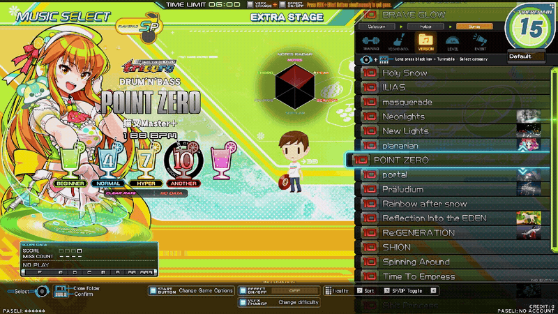

# POINT ZERO

Adds custom **1.0–12.9 difficulty ratings** and decimal LEVEL folders to IIDX!

Includes 10,000+ custom ratings modelled from e-amusement data across SP and DP, plus community tables like CPI, IRT, SNJ and ereter.

## Install

1. Extract `point-zero.zip` into `contents/modules/`.
2. Add `point-zero.dll` to Spice config’s Inject DLL Hooks (`-k`) list.

Press **keypad 8** at song select to toggle ON / OFF. Enable optional ratings and other settings in `point-zero.conf`.

